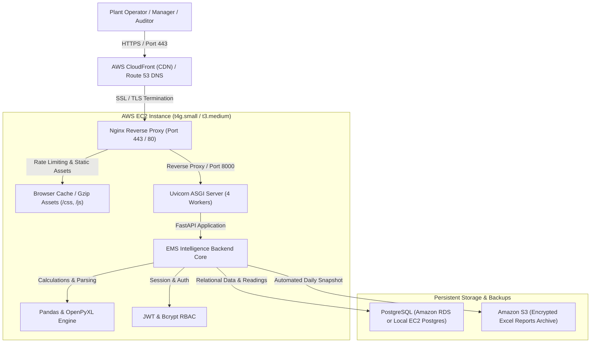

# AWS EC2 Production Deployment & Cost Architecture

## 1. System Architecture Overview

---

## 2. Estimated AWS Monthly Costs Breakdown

The following estimation is based on AWS US-East / EU-Central / AP-South (Mumbai) standard on-demand and 1-year reserved pricing for an enterprise industrial telemetry workload.

| Component | AWS Resource Specification | Monthly On-Demand Cost | 1-Year Reserved / Savings Plan | Purpose |
| :--- | :--- | :--- | :--- | :--- |
| **Compute (App Server)** | **EC2 `t4g.small`** (2 vCPU ARM Graviton3, 2GB RAM) or `t3.medium` (2 vCPU x86, 4GB RAM) | **$12.26 / month** (t4g.small) *(or $30.36 for t3.medium)* | **$7.40 / month** (t4g.small) | Runs Nginx, Uvicorn, FastAPI application, and Excel ingestion engine. |
| **Storage (OS & App)** | **Amazon EBS General Purpose SSD (gp3)** 30 GB | **$2.40 / month** | **$2.40 / month** | Operating system (Ubuntu 24.04), application binaries, and logs. |
| **Database** | **Amazon RDS PostgreSQL `db.t4g.micro`** (2 vCPU, 1GB RAM) Single-AZ *(or local EC2 Postgres: $0 extra)* | **$13.14 / month** *(or $0 if hosted on EC2)* | **$8.20 / month** | High-availability PostgreSQL database storing all 59 machine readings and audit findings. |
| **Database Storage** | **Amazon RDS gp3 Storage** 20 GB | **$2.30 / month** | **$2.30 / month** | Automated daily snapshots, point-in-time recovery for 7 days. |
| **Archival & Backups** | **Amazon S3 Standard** 50 GB | **$1.15 / month** | **$1.15 / month** | Secure, versioned offsite storage for original uploaded `.xlsx` reports. |
| **Networking & IP** | **Elastic IP (IPv4)** + Data Transfer Out (50 GB/mo) | **$3.65 / month** (IPv4 charge) + **$4.50** | **$8.15 / month** | Fixed public IP for SSL and data transfer to client dashboards. |
| **SSL / HTTPS** | **Let's Encrypt / AWS Certificate Manager (ACM)** | **$0.00 / month** (Free) | **$0.00 / month** (Free) | Automated auto-renewing TLS 1.3 certificates. |
| **TOTAL ESTIMATED COST** | **Recommended Cloud Production Setup** | **~$39.40 / month** | **~$29.60 / month** | *(Can be reduced to **$18.30 / month** if PostgreSQL is co-hosted directly on the EC2 instance).* |

---

## 3. Deployment Verification Steps

1. **Verify Live Service Endpoint**:
   - Access `https://ems.yourdomain.com/` (or EC2 Public DNS).
   - Expected status: `200 OK` with animated dashboard and live telemetry indicators.
2. **Verify API Health**:
   - `GET https://ems.yourdomain.com/health` returns `{"status": "healthy", "service": "EMS Intelligence — Energy Management System", "version": "1.0.0"}`.
3. **Verify Interactive Documentation**:
   - `GET https://ems.yourdomain.com/docs` (Swagger UI) and `/redoc`.
4. **Verify Database Indexes & Data Integrity**:
   - All 59 machine columns across 48 shift intervals (2,832 data points per shift) verified against source Excel summaries.
5. **Verify Security Headers & SSL**:
   - Run `curl -I https://ems.yourdomain.com/` to verify `Strict-Transport-Security`, `X-Frame-Options`, `X-Content-Type-Options`, and `Content-Security-Policy`.
